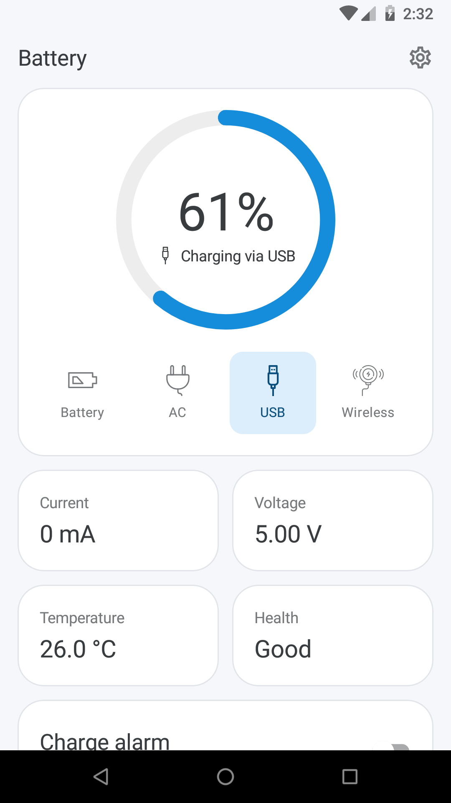
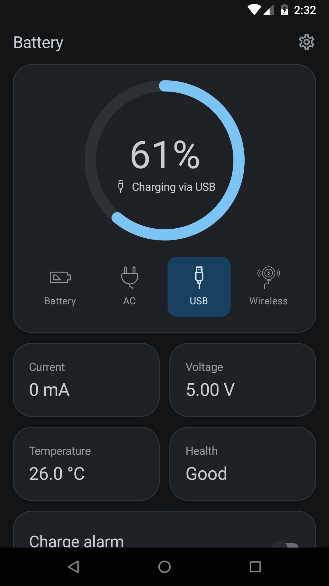

# Battery

An Android app built with Jetpack Compose that shows live battery statistics and tells you when to unplug the charger, so the battery wears out more slowly.

<p align="center">
	
	
</p>

## Why I built it

I built Battery in 2020 for my own phone, a General Mobile GM9. I had two goals: see what the battery was doing (how much current it drew, how warm it got, what voltage it ran at) and make the battery last longer.

Lithium-ion batteries wear out faster when they stay at full charge and when they run hot. Along with the live stats, the app has a charge alarm. I set a limit, such as 80%, and the phone tells me to unplug the charger when the battery reaches it.

## Three versions of the same app

After the first version, I kept using this app as a practice project and rebuilt it twice with new tools. Each version has its own branch:

| Year | Branch | What it is |
| --- | --- | --- |
| 2020 | [`legacy`](https://github.com/ermanergoz/battery/tree/legacy) | The original app: Kotlin, XML layouts, MVVM with ViewModel and LiveData |
| 2021 | [`rxjava`](https://github.com/ermanergoz/battery/tree/rxjava) | The same app with its asynchronous code rewritten in RxJava 3, to practise reactive programming |
| 2022 | [`main`](https://github.com/ermanergoz/battery/tree/main) | **This branch, the latest version.** The UI rebuilt in Jetpack Compose, which I did to learn and practise Compose |

The features are mostly the same in all three versions, so you can compare the branches to see how each stack handles the same problems.

## Features

- Battery percentage, current, temperature and voltage, updated live
- The charging source: AC, USB, wireless or discharging
- Battery health, status and technology
- An ongoing notification with live battery stats
- A charge alarm that notifies you when the battery reaches the limit you set
- After a reboot or an app update, the notification and the alarm start again if they were on
- A shortcut to the system's battery usage screen
- Light and dark themes, following the system or chosen in the settings

## What this project shows

- I built a complete app for a real need, from the idea to a working app on my own phone
- It uses Android platform APIs: battery broadcasts and `BatteryManager`, a foreground service, notification channels, a boot receiver and settings
- The data layer, the alarm rules, the background service and the UI are kept separate. Unit tests cover the logic, and Compose UI tests cover the screens
- I moved an existing XML-based app to Jetpack Compose and kept its behaviour the same (compare with [`legacy`](https://github.com/ermanergoz/battery/tree/legacy))

## How this version works

- The whole UI is written in Jetpack Compose, with no XML layouts
	- The main and settings screens are built from small composables: the battery gauge, the charging source row, and cards for the statistics, the battery details and the charge alarm
	- The Material theme is written in Compose, with light and dark color palettes, typography and shapes
	- The screens get their state from the ViewModels' `LiveData` through `observeAsState`
	- Compose UI tests cover the composables of both screens
- Kotlin
- MVVM with ViewModel and LiveData
- A foreground service runs the ongoing notification and the charge alarm, and a boot receiver starts it again after a reboot or an app update
- `ChargeAlarm` holds the alarm rule. It alerts once when the battery reaches the limit while charging, and it does not repeat while the level moves up and down around the limit

## Build & Run

- Clone the repository:

	```sh
	git clone https://github.com/ermanergoz/battery.git
	```

- Open the project in Android Studio with **File > Open** and select the cloned folder. When Gradle sync finishes, the app is ready to run.

This branch uses Jetpack Compose 1.0.5, Kotlin 1.5.31, Android Gradle Plugin 7.0.4, Gradle 7.3.3, compile SDK 30, min SDK 23 (Android 6.0). The app version is 2.0.0.

## Tests

The project has unit tests for the battery status mapping, the charge alarm rules and the theme setting, and Compose UI tests for the main and settings screens.

Unit tests run on the JVM, so you do not need a device:

```sh
./gradlew test
```

UI tests need a connected device or an emulator:

```sh
./gradlew connectedAndroidTest
```

## Status

This is the latest version of the app. The earlier versions are on the [`legacy`](https://github.com/ermanergoz/battery/tree/legacy) and [`rxjava`](https://github.com/ermanergoz/battery/tree/rxjava) branches.

## Meta

Yusuf Erman ERGÖZ – erman.ergoz@gmail.com

Distributed under the MIT license. See ``LICENSE`` for more information.

[https://github.com/ermanergoz](https://github.com/ermanergoz)

## Acknowledgements

Icons from [Flaticon](https://www.flaticon.com/): the app logo by Smashicons, the discharging icon by Icongeek26, the USB and wireless charging icons by Freepik, and the AC charging icon by Pixel perfect.
