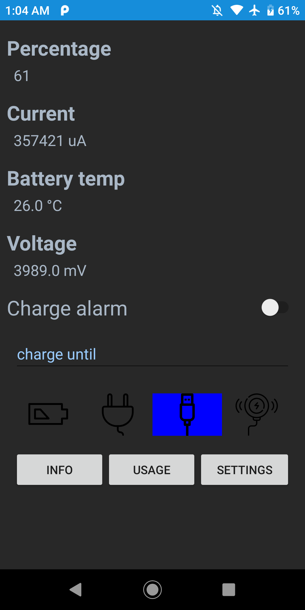

# Battery

An Android app that shows live battery statistics and tells you when to unplug the charger, so the battery wears out more slowly.

<p align="center">
	
</p>

## Why I built it

I built Battery in 2020 for my own phone, a General Mobile GM9. I had two goals: see what the battery was doing (how much current it drew, how warm it got, what voltage it ran at) and make the battery last longer.

Lithium-ion batteries wear out faster when they stay at full charge and when they run hot. Along with the live stats, the app has a charge alarm. I set a limit, such as 80%, and the phone tells me to unplug the charger when the battery reaches it.

## Three versions of the same app

After the first version, I kept using this app as a practice project and rebuilt it twice with new tools. Each version has its own branch:

| Year | Branch | What it is |
| --- | --- | --- |
| 2020 | [`legacy`](https://github.com/ermanergoz/battery/tree/legacy) | The original app: Kotlin, XML layouts, MVVM with ViewModel and LiveData |
| 2021 | [`rxjava`](https://github.com/ermanergoz/battery/tree/rxjava) | **This branch.** The same app with its asynchronous code rewritten in RxJava 3, to practise reactive programming |
| 2022 | [`main`](https://github.com/ermanergoz/battery/tree/main) | The latest version: the UI rebuilt in Jetpack Compose, which I did to learn and practise Compose |

The features are mostly the same in all three versions, so you can compare the branches to see how each stack handles the same problems.

## Features

- Battery percentage, current, temperature and voltage, updated live
- The charging source: AC, USB, wireless or discharging
- Battery health, status and technology, in the info dialog
- An ongoing notification with live battery stats
- A charge alarm that notifies you when the battery reaches the limit you set
- After a reboot or an app update, the notification and the alarm start again if they were on
- A shortcut to the system's battery usage screen
- Light and dark themes, following the system or chosen in the settings

## What this project shows

- I built a complete app for a real need, from the idea to a working app on my own phone
- It uses Android platform APIs: battery broadcasts and `BatteryManager`, a foreground service, notification channels, a boot receiver and settings
- The data layer, the alarm rules, the background service and the UI are kept separate, and unit tests cover the logic
- I refactored the same codebase onto new technologies and kept its behaviour the same (compare with [`legacy`](https://github.com/ermanergoz/battery/tree/legacy))

## How this version works

The screens and features match the `legacy` branch. In this version, RxJava 3 replaces LiveData and coroutines for all asynchronous work:

- `batteryStatusChanges()` wraps the battery broadcast receiver in `Observable.create`, and the receiver is unregistered when the stream is disposed
- `BatteryRepository` shares that stream with `replay(1).refCount()`, so the screen and the background service use one receiver, and a new subscriber gets the latest reading right away
- The current is polled with `Observable.interval` on the computation scheduler and delivered on the main thread with `observeOn(AndroidSchedulers.mainThread())`. RxJava streams cannot carry `null`, so a device that does not report the current sends an empty `CurrentReading` and the stream does not break
- `MainViewModel` keeps the alarm switch and input validation state in `BehaviorSubject`s and exposes them as plain `Observable`s with `hide()`
- `MainActivity` collects its subscriptions in a `CompositeDisposable`, starts them in `onStart` and clears them in `onStop`. `BatteryService` disposes its subscription in `onDestroy`
- The polling is unit tested with a `TestScheduler`, which moves time forward virtually, so the tests do not wait for real seconds

The rest is the same as `legacy`: Kotlin, XML layouts with View Binding, MVVM, a foreground service with a boot receiver, and AndroidX Preference for the settings.

## Build & Run

- Clone this branch:

	```sh
	git clone -b rxjava https://github.com/ermanergoz/battery.git
	```

- Open the project in Android Studio with **File > Open** and select the cloned folder. When Gradle sync finishes, the app is ready to run.

This branch still uses the build tools it was written with: RxJava 3.0.12, RxAndroid 3.0.0, Kotlin 1.3.70, Android Gradle Plugin 4.0.0, Gradle 6.1.1, compile SDK 29, min SDK 23 (Android 6.0). The app version is 1.0.1.

## Tests

The project has unit tests for the battery status mapping, the charge alarm rules, the theme setting and the RxJava current polling. They run on the JVM, so you do not need a device:

```sh
./gradlew test
```

## Status

Archived. This branch keeps the app as it was in 2021. The latest version is on the [`main`](https://github.com/ermanergoz/battery/tree/main) branch.

## Meta

Yusuf Erman ERGÖZ – erman.ergoz@gmail.com

Distributed under the MIT license. See ``LICENSE`` for more information.

[https://github.com/ermanergoz](https://github.com/ermanergoz)

## Acknowledgements

Icons from [Flaticon](https://www.flaticon.com/): the app logo by Smashicons, the discharging icon by Icongeek26, the USB and wireless charging icons by Freepik, and the AC charging icon by Pixel perfect.
